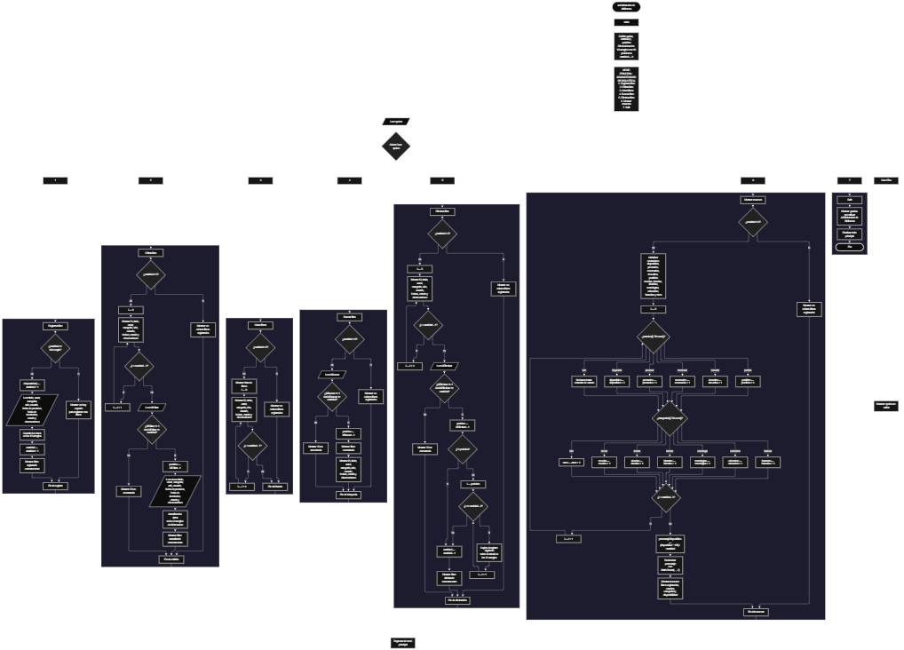

Este proyecto, llamado <b>administrador de biblioteca</b>, fue desarrollado en <b>visual basic .net</b> como un ejercicio práctico para fortalecer la lógica de programación mediante la creación de un sistema de gestión de libros desde la consola. El programa cuenta con un menú principal de siete opciones que permite <b>registrar, editar, eliminar, buscar, listar y consultar un resumen</b> de los libros almacenados. Cada libro contiene información como el título, autor, categoría, año, usuario, fecha de préstamo, fecha de devolución, estado y observaciones, utilizando arreglos con una capacidad máxima de <b>10 libros durante la ejecución</b>. Durante su desarrollo se aplicaron conceptos fundamentales de programación, como variables, arreglos, estructuras condicionales, ciclos repetitivos y estructuras de selección, además de procesos para buscar, modificar, eliminar y reorganizar registros. Este proyecto permite poner en práctica los conocimientos adquiridos en Visual Basic .NET y sirve como base para desarrollar sistemas de administración más avanzados utilizando otros lenguajes y tecnologías.

<h2 align="center">⚙️ Funcionamiento del menú principal</h2>

### ➕ Registrar libro

La opción <b>1) registrar libro</b> permite agregar un nuevo libro al sistema. Antes de realizar el registro, el programa comprueba que la cantidad de libros almacenados sea menor a la capacidad del arreglo, utilizando la condición <b>cantidad &gt;= ids.Length</b>. Si se alcanza el límite de <b>10 libros</b>, muestra el mensaje <b>"no hay espacio para registrar mas libros."</b> e impide agregar otro registro. Si existe espacio disponible, asigna un identificador mediante la instrucción <b>ids(cantidad) = cantidad + 1</b> y solicita los datos del libro: <b>título, autor, categoría, año, usuario, fecha de préstamo, fecha de devolución, estado y observaciones</b>. Cada dato se almacena en la posición correspondiente de su respectivo arreglo. Finalmente, aumenta la variable <b>cantidad</b> en uno y muestra el mensaje <b>"libro registrado correctamente."</b>.

### ✏️ Editar libro

La opción <b>2) editar libro</b> permite modificar la información de un libro registrado. Primero, el programa comprueba si existen libros almacenados mediante la variable <b>cantidad</b>. Si no hay registros, muestra el mensaje <b>"no existen libros registrados."</b>. En caso contrario, utiliza un ciclo <b>For...Next</b> para mostrar la información de todos los libros, incluyendo su ID, título, autor, categoría, año, usuario, fechas de préstamo y devolución, estado y observaciones. Después, solicita el ID del libro que se desea editar y comprueba que esté dentro del rango permitido mediante la condición <b>idEditar &gt;= 1 And idEditar &lt;= cantidad</b>. Si la selección es válida, calcula la posición mediante <b>posicion = idEditar - 1</b> y solicita los nuevos datos del libro. La información se actualiza directamente en los arreglos correspondientes. Finalmente, presenta el mensaje <b>"libro actualizado correctamente."</b>. Si el ID introducido no está dentro del rango permitido, muestra el mensaje <b>"id no encontrada."</b>.

### 📋 Listar libros

La opción <b>3) listar libros</b> permite visualizar todos los libros registrados actualmente en el sistema. Antes de mostrar la información, el programa comprueba si la variable <b>cantidad</b> es igual a cero. Si no existen libros registrados, presenta el mensaje <b>"no existen libros registrados."</b>. Si hay registros disponibles, muestra el encabezado <b>"lista de libros"</b> y utiliza un ciclo <b>For...Next</b> para recorrer los arreglos desde la primera posición hasta el número total de libros almacenados. Durante el recorrido, muestra el ID, título, autor, categoría, año, usuario, fecha de préstamo, fecha de devolución, estado y observaciones de cada libro. Esta función facilita consultar los registros existentes sin necesidad de buscar cada libro individualmente.

### 🔎 Buscar libro

La opción <b>4) buscar libro</b> permite localizar un libro mediante su identificador. Primero, el programa comprueba si existen libros registrados. Si la biblioteca está vacía, muestra el mensaje <b>"no existen libros registrados."</b>. En caso contrario, solicita el ID del libro que se desea buscar y verifica que esté dentro del rango permitido mediante la condición <b>idBuscar &gt;= 1 And idBuscar &lt;= cantidad</b>. Si el identificador es válido, calcula la posición correspondiente utilizando <b>posicion = idBuscar - 1</b> y muestra el mensaje <b>"libro encontrado"</b>, seguido de toda la información del libro: título, autor, categoría, año, usuario, fechas de préstamo y devolución, estado y observaciones. Si el ID introducido no corresponde al rango de registros existentes, presenta el mensaje <b>"id no encontrada."</b>.

### 🗑️ Eliminar libro

La opción <b>5) eliminar libro</b> permite eliminar un libro registrado mediante su identificador. Antes de comenzar, el programa comprueba que existan libros almacenados. Si no hay registros, muestra el mensaje <b>"no existen libros registrados."</b>. Si hay libros disponibles, utiliza un ciclo <b>For...Next</b> para mostrar la información de todos los registros. Después, solicita el ID del libro que se desea eliminar y comprueba que esté dentro del rango permitido mediante la condición <b>idEliminar &gt;= 1 And idEliminar &lt;= cantidad</b>. Si el ID es válido, calcula la posición del registro y comienza el proceso de eliminación. Para mantener organizados los datos, utiliza otro ciclo <b>For...Next</b> que desplaza una posición hacia la izquierda la información de los libros posteriores en los diez arreglos: <b>ids, titulos, autores, categorias, anios, usuarios, fechasPrestamo, fechasDevolucion, estados y observaciones</b>. Posteriormente, disminuye la variable <b>cantidad</b> en uno y muestra el mensaje <b>"libro eliminado correctamente."</b>. Si el ID seleccionado no corresponde al rango permitido, presenta el mensaje <b>"id no encontrada."</b>.

### 📊 Mostrar resumen

La opción <b>6) mostrar resumen</b> permite consultar estadísticas generales de los libros registrados en la biblioteca. Primero, el programa comprueba si existen registros almacenados. Si no hay libros, muestra el mensaje <b>"no existen libros registrados."</b>. En caso contrario, inicializa varios contadores para clasificar los libros según su estado y categoría. Después, utiliza un ciclo <b>For...Next</b> para recorrer los registros y contabilizar los estados <b>disponible, prestado, reservado, devuelto y perdido</b>. También clasifica las categorías en <b>novela, ciencia, historia, tecnología, educación, fantasía y otros</b>. Para calcular la cantidad de libros de cada grupo, utiliza estructuras condicionales <b>If...ElseIf...Else</b> y convierte los textos a minúsculas mediante <b>.ToLower()</b> antes de compararlos. Finalmente, calcula el porcentaje de libros disponibles mediante la fórmula <b>(disponibles * 100) / cantidad</b> y utiliza <b>Math.Round(porcentajeDisponibles, 2)</b> para mostrar el resultado con dos decimales. El resumen presenta la cantidad total de libros, sus estados, categorías y el porcentaje de disponibilidad.

### 🚪 Salir del menú principal

La opción <b>7) salir</b> permite finalizar la ejecución del programa y muestra el mensaje <b>"gracias por utilizar administrador de biblioteca."</b>. El menú principal se encuentra dentro de una estructura repetitiva <b>Do...Loop While</b>, que mantiene el programa en funcionamiento mientras la variable <b>opcion</b> sea diferente de <b>7</b>. Cuando el usuario selecciona esta opción, se ejecuta el mensaje de despedida y la condición <b>opcion &lt;&gt; 7</b> deja de cumplirse, finalizando el ciclo y la ejecución del programa.

<h2 align="center">🧠 Temas aplicados en el proyecto</h2>

### 📦 Variables

En este proyecto se utilizan variables para controlar la cantidad de libros registrados, almacenar la opción seleccionada en el menú, identificar los libros que se desean editar, buscar o eliminar y llevar el control de las estadísticas generadas en el resumen. Cada variable cumple una función específica dentro de las operaciones de administración de la biblioteca.

🔢 **Opcion:** Almacena la opción seleccionada por el usuario en el menú principal.

📊 **Cantidad:** Controla el número total de libros registrados durante la ejecución del programa.

🔄 **I:** Funciona como contador en los ciclos <b>For...Next</b> y permite recorrer las posiciones de los arreglos.

🔎 **IdEditar:** Almacena el identificador del libro que se desea modificar.

🔍 **IdBuscar:** Almacena el identificador del libro que se desea localizar.

🗑️ **IdEliminar:** Almacena el identificador del libro que se desea eliminar.

📍 **Posicion:** Determina la posición del arreglo correspondiente al ID seleccionado mediante la operación <b>id - 1</b>.

📊 **Disponibles, Prestados, Reservados, Devueltos y Perdidos:** Son contadores que almacenan la cantidad de libros clasificados según su estado.

📚 **Novelas, Ciencias, Historias, Tecnologias, Educacion, Fantasias y Otros:** Son contadores que almacenan la cantidad de libros clasificados según su categoría.

📈 **PorcentajeDisponibles:** Almacena el porcentaje de libros que se encuentran disponibles en la biblioteca.

### 🗃️ Arreglos

En este proyecto se utilizan diez arreglos relacionados con la información de cada libro. Cada arreglo tiene una capacidad de <b>10 posiciones</b> y utiliza el mismo índice para representar los datos correspondientes a un mismo registro. Por ejemplo, la información de un libro almacenado en la posición <b>0</b> se encuentra distribuida entre <b>ids(0), titulos(0), autores(0), categorias(0), anios(0), usuarios(0), fechasPrestamo(0), fechasDevolucion(0), estados(0) y observaciones(0)</b>. Esta organización permite recorrer, modificar, mostrar y eliminar los registros de manera ordenada.

🆔 **Ids(10):** Almacena los identificadores de los libros registrados.

📖 **Titulos(10):** Almacena los títulos de los libros.

✍️ **Autores(10):** Almacena los nombres de los autores.

📚 **Categorias(10):** Almacena las categorías de los libros.

📅 **Anios(10):** Almacena los años de publicación.

👤 **Usuarios(10):** Almacena los nombres de los usuarios asociados a los libros.

📥 **FechasPrestamo(10):** Almacena las fechas de préstamo de los libros.

📤 **FechasDevolucion(10):** Almacena las fechas de devolución de los libros.

📌 **Estados(10):** Almacena los estados actuales de los libros.

📝 **Observaciones(10):** Almacena las observaciones adicionales de cada libro.

### 🔀 Estructuras condicionales

En este proyecto se utilizan las estructuras <b>If...Then</b>, <b>ElseIf</b> y <b>Else</b> para comprobar si existen libros registrados antes de realizar determinadas operaciones, verificar si todavía hay espacio disponible para registrar nuevos libros, validar los identificadores utilizados durante la edición, búsqueda y eliminación, y clasificar los libros según sus estados y categorías durante la generación del resumen. Estas condiciones permiten que el programa responda de manera diferente según la información almacenada y el resultado de cada comprobación.

### 🔄 Estructuras repetitivas

En este proyecto se utilizan las estructuras repetitivas <b>Do...Loop While</b> y <b>For...Next</b>. El ciclo <b>Do...Loop While</b> mantiene activo el menú principal para que el usuario pueda realizar diferentes operaciones hasta seleccionar la opción de salida. Por otro lado, los ciclos <b>For...Next</b> permiten recorrer los arreglos para mostrar los libros registrados, consultar sus datos y procesar la información del resumen. También se utilizan durante la eliminación para desplazar los registros posteriores una posición hacia la izquierda, manteniendo organizada la información almacenada.

### 🎯 Estructura Select Case

El programa utiliza la estructura <b>Select Case</b> para evaluar el valor almacenado en la variable <b>opcion</b> y ejecutar el bloque de instrucciones correspondiente. Cada caso representa una operación específica del sistema: <b>registrar libro, editar libro, listar libros, buscar libro, eliminar libro, mostrar resumen o salir</b>. También se utiliza el bloque <b>Case Else</b> para mostrar el mensaje <b>"opcion no valida."</b> cuando el usuario introduce un número que no coincide con ninguna de las opciones definidas en el menú.

### 🔢 Dimensionamiento de arreglos

El programa utiliza la declaración <b>Dim</b> para establecer los arreglos que almacenan la información de los libros. Cada arreglo se declara con el límite superior <b>(9)</b>, lo que permite utilizar las posiciones comprendidas entre <b>0 y 9</b>, equivalentes a una capacidad total de <b>10 registros</b>. La cantidad de posiciones ocupadas se controla mediante la variable <b>cantidad</b>, por lo que las operaciones recorren únicamente los registros comprendidos entre la primera posición y el total actual de libros.

### 🔄 Reorganización de registros

Cuando se selecciona un libro para eliminarlo, el programa utiliza un ciclo <b>For...Next</b> que comienza en la posición seleccionada y continúa hasta <b>cantidad - 2</b>. En cada repetición, los datos de la posición siguiente se copian sobre la posición actual en los diez arreglos del proyecto. De esta manera, los libros posteriores ocupan las posiciones disponibles sin dejar espacios vacíos entre los registros activos. Finalmente, la variable <b>cantidad</b> disminuye en uno para actualizar el número de libros almacenados. Sin embargo, el código no renumera los identificadores después de desplazar los registros.

<h2 align="center">¿Cómo se implementaron las operaciones crud en el proyecto?</h2>

Las operaciones <b>crud</b> se implementaron mediante las opciones del menú principal, permitiendo administrar los libros registrados en la biblioteca. La operación <b>crear</b> corresponde a <b>registrar libro</b>, donde se introducen los datos de un nuevo registro; <b>leer</b> se realiza mediante las opciones <b>buscar libro y listar libros</b>, que permiten consultar la información almacenada; <b>actualizar</b> corresponde a <b>editar libro</b>, donde se modifican los datos de un libro registrado; y <b>eliminar</b> se realiza mediante la opción <b>eliminar libro</b>, que retira un registro y reorganiza los datos de los arreglos. Estas operaciones utilizan variables, arreglos, estructuras condicionales y ciclos repetitivos para administrar la información almacenada temporalmente durante la ejecución del programa.

<h2 align="center">Diagrama de flujo del proyecto</h2>

<h2 align="center">🛡️ Validaciones del programa</h2>

### 📭 No existen libros registrados

Esta validación se utiliza en las opciones de <b>editar, listar, buscar, eliminar y mostrar resumen</b>. El programa comprueba si la variable <b>cantidad</b> es igual a <b>0</b> y, si no existen libros registrados, muestra el mensaje <b>"no existen libros registrados."</b>. Esta comprobación evita continuar con las operaciones que necesitan información almacenada cuando la biblioteca está vacía.

### ⚠️ Capacidad máxima de libros

Esta validación se utiliza durante el registro de nuevos libros para controlar la capacidad máxima de los arreglos. El programa comprueba si <b>cantidad &gt;= ids.Length</b> antes de permitir agregar otro registro. Como los arreglos tienen una capacidad de <b>10 posiciones</b>, cuando se alcanza ese límite muestra el mensaje <b>"no hay espacio para registrar mas libros."</b> e impide continuar con el registro. Si existe espacio disponible, permite almacenar los datos y aumenta la variable <b>cantidad</b> en uno.

### 🔢 Identificador de libro

Esta validación se utiliza durante las operaciones de <b>editar, buscar y eliminar</b>. El programa comprueba que el identificador introducido sea mayor o igual a <b>1</b> y menor o igual a la variable <b>cantidad</b>. Si el ID se encuentra dentro del rango permitido, calcula la posición correspondiente mediante <b>posicion = id - 1</b> y ejecuta la operación solicitada. Si el identificador está fuera del rango, muestra el mensaje <b>"id no encontrada."</b>. Esta comprobación permite controlar que las operaciones se realicen sobre posiciones comprendidas dentro de la cantidad actual de registros.

### 📊 Clasificación de estados y categorías

Durante la generación del resumen, el programa utiliza estructuras condicionales para reconocer los estados <b>disponible, prestado, reservado, devuelto y perdido</b>. También clasifica las categorías <b>novela, ciencia, historia, tecnologia, educacion y fantasia</b>. Para realizar las comparaciones utiliza el método <b>.ToLower()</b>, que convierte los textos a minúsculas. Las categorías que no coinciden con ninguna de las opciones establecidas se contabilizan dentro del grupo <b>otros</b>. Los estados que no coinciden con los valores definidos no se incluyen en los contadores de estados.

### ⚠️ Entrada de datos

El programa utiliza <b>Convert.ToInt32</b> para convertir las entradas correspondientes a los años, las opciones del menú y los identificadores en valores numéricos enteros. Si el usuario introduce un texto que no puede convertirse a un número, puede producirse una excepción durante la ejecución. Además, los campos de texto y las fechas se almacenan sin comprobar si están vacíos o si contienen un formato válido. Por tanto, el programa realiza conversiones de datos, pero no implementa validaciones completas de entrada.

### 🆔 Identificadores después de eliminar registros

Cuando se elimina un libro, el programa desplaza los datos de los registros posteriores hacia la izquierda, pero no actualiza los identificadores almacenados en el arreglo <b>ids</b>. Debido a que las opciones de edición, búsqueda y eliminación calculan la posición utilizando <b>id - 1</b>, después de eliminar un registro intermedio los identificadores pueden dejar de coincidir con las posiciones reales de los libros. Esta situación puede provocar que se seleccione un registro diferente al esperado en operaciones posteriores.

### ❌ Opción inválida

La estructura <b>Select Case</b> incluye el bloque <b>Case Else</b>, que muestra el mensaje <b>"opcion no valida."</b> cuando el usuario introduce un número que no corresponde a ninguna de las siete opciones definidas en el menú. Esta comprobación permite informar al usuario cuando selecciona una opción que no está disponible en el programa.

<h2 align="center">🎯 Objetivo del proyecto</h2>

El objetivo principal de este proyecto es fortalecer la <b>lógica de programación</b> mediante el desarrollo de un sistema de administración de biblioteca en <b>visual basic .net</b>. A través de su construcción se busca aplicar los conocimientos adquiridos sobre variables, arreglos, estructuras condicionales, ciclos repetitivos y estructuras de selección, integrándolos para resolver un problema de manera organizada. Además, el proyecto permite comprender cómo registrar, consultar, modificar y eliminar información utilizando arreglos, así como generar estadísticas mediante el procesamiento de registros. De esta manera, se establece una base para desarrollar sistemas de administración más completos utilizando otros lenguajes y tecnologías.

